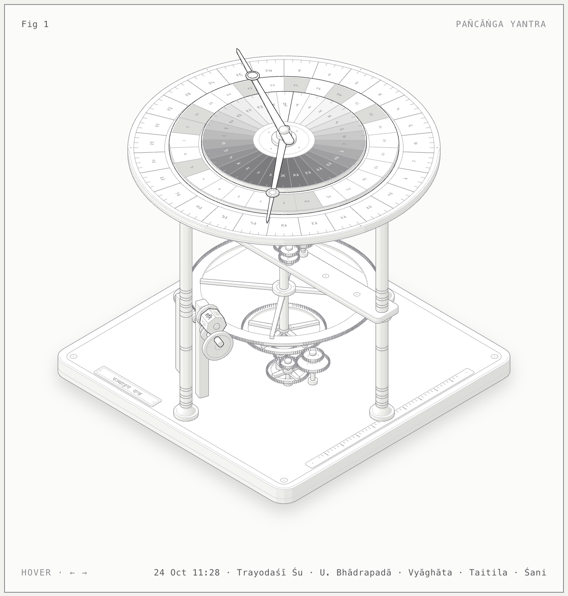

# Kālacakra Pañcāṅga

An interactive Hindu pañcāṅga that shows *how* the almanac is made, not just its answers. Every limb is computed live in the browser from the positions of the Sun and Moon.

**Live:** https://nikitph.github.io/kalacakra-panchang/


## What's on the page

- **Kālacakra, the sky-wheel.** Rings for the 27 nakṣatras (with all 108 pādas), the 12 sidereal rāśis and the 27 yogas. The tithi ring turns with the Sun, because a tithi is the Moon's lead over the Sun in 12° steps. Each cell is shaded by how lit the Moon is, so the ring doubles as the lunar phase cycle. Karaṇa ticks sit inside it, with Viṣṭi (Bhadrā) in red. A gold wedge from the centre spans the elongation.
- **Ahorātra, the day ribbon.** Runs sunrise to sunrise, because the Hindu day begins at sunrise. Rows show the 30 muhūrtas (Abhijit and Brahma marked), Rāhu kāla, Yamagaṇḍa and Gulika, every limb's change time, and the planetary horās. Times are given in IST along the top and in ghaṭī from sunrise along the bottom. Drag across it to scrub through the day.
- **The five limbs.** Each limb's card shows its own working (for example `☾ − ☉ = 154°31′ ÷ 12° → tithi 13`), progress, start and end times, deity and class.
- **The month weave.** The lunar month's 30 tithis are set against the civil days whose sunrise falls in each one. This exposes kṣaya tithis, which never meet a sunrise, and vṛddhi tithis, which span two. Festivals are placed by their own rule: the tithi at sunrise, midday, afternoon, dusk or midnight.
- **Live mode.** The page follows the clock, counting time since sunrise in ghaṭī · pala · vipala. *Run time* plays a day every ten seconds.

Also shown: adhika māsa detection, amānta and pūrṇimānta month names, saṅkrānti times, samvatsara, ṛtu and ayana, and twelve Indian cities, with Ujjain as the default.

## Pañcāṅga yantra

**Live:** https://nikitph.github.io/kalacakra-panchang/yantra/



The same five limbs worked out by gears, drawn as a brass skeleton almanac clock in the isometric style of the Anatomy figure kit.

- The **tithi disc** rides the Sun's tube, so the Moon hand reads the Moon's lead over the Sun.
- The **yoga disc** is turned backwards by a three-wheel reverser, so the same hand reads the Sun and Moon added together.
- The fixed ring on the deck carries the 27 **nakṣatras** in 108 pādas, and the tithi disc's rim carries the **karaṇa** half-ticks.
- The Sun drives the Moon through the Antikythera mechanism's ratio, 127/32 · 50/25 · 64/38 = 254/19, the Metonic cycle. A worm turned once a day drives a 365-tooth year wheel.
- A pin on the crank shaft steps a seven-sided **vāra** drum at sunrise, when the Hindu day begins.
- The wheels carry the mean motions; the hands show the true Sun and Moon.

Hover to scrub ±15 days, use ← → to step a day (Shift for an hour), and Home to return to now. `yantra/index.html` is self-contained. To rebuild it, run `node yantra/build.mjs --light` with the Anatomy skill's kit available (set `ANATOMY` to its folder).

## How it's calculated

- **Sun:** a low-precision solar theory.
- **Moon:** a truncated lunar theory (about 45 periodic terms).
- **Zodiac:** the Lahiri (Citrāpakṣa) ayanāṁśa.
- **Sunrise:** the standard sunrise equation.

Change times are good to a few minutes. Local traditions differ on festival dates and samvatsara reckoning.

## Running it

It's one self-contained `index.html` with no build step and no dependencies beyond Google Fonts. Open it in a browser, or serve the folder:

```bash
python3 -m http.server
```
